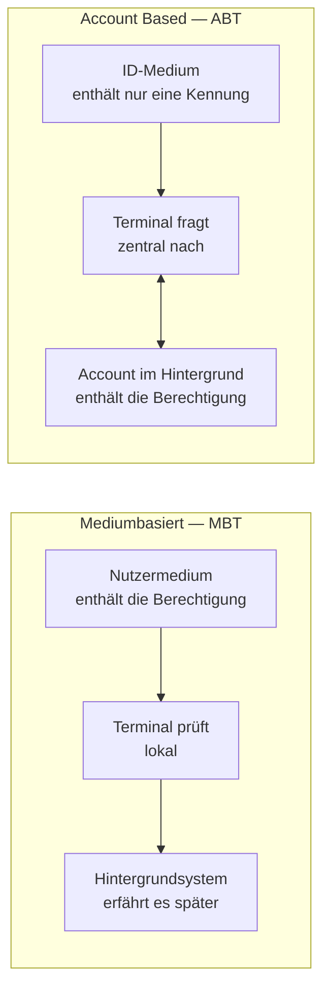

<!-- GEN:breadcrumb -->
[Home](../README.md) › Account Based Ticketing
<!-- /GEN:breadcrumb -->

# Account Based Ticketing

Account Based Ticketing bezeichnet ein Ticketing-System, „in dem Fahrtberechtigungen **nicht länger auf physischen Nutzermedien gespeichert**, sondern über eine **eindeutige ID** direkt mit dem Kundenkonto im Hintergrundsystem oder in der Cloud verknüpft werden“. Fahrgäste weisen sich mit einem persönlichen Identifikationsmittel aus — Kreditkarten, Chipkarten oder Apps ([Q02](../QUELLEN.md#q02), S. 16).

Die VDV eTS fasst den Kern in einem Satz: „Das Account-Based-Ticketing **dreht die Logik des Speicherortes um**.“ ([Q01](../QUELLEN.md#q01))

**Nicht auf dem Medium heißt nicht ohne Medium:** Ein ID-Medium bleibt nötig, es trägt aber nur noch eine Kennung ([Q30](../QUELLEN.md#q30), Kap. 5.2.2).

**Die Berechtigung in der Cloud ist bereits vorgesehen.** Das Glossar nennt als Ablageform einer Berechtigung ausdrücklich „das Hinterlegen der Berechtigung in einer Cloud, auf die dann mit Hilfe einer eindeutigen ID zugegriffen werden kann“ ([Q02](../QUELLEN.md#q02), S. 30). ABT ist also kein Bruch mit der Kernapplikation (abgeleitet).

**Der Preis ist Konnektivität:** „Da der Großteil der Verarbeitung zentral erfolgt, ist die Konnektivität von entscheidender Bedeutung.“ ([Q01](../QUELLEN.md#q01)) Daraus entstehen [Hybridsysteme](abt/hybridsystem.md) — die aber „i. d. R. die Wirtschaftlichkeit reduzieren“ ([Q01](../QUELLEN.md#q01)).

In der KA ist ABT als Erweiterung um die [Ausbaustufen 4 und 5](abt/abt-in-der-kernapplikation.md) vorgesehen ([Q01](../QUELLEN.md#q01)).

## Einfach erklärt – Beispiel aus Bärstadt

Der Unterschied lässt sich an einer Frage festmachen: **Wo liegt das Ticket?**

Bei Pia Brummbär liegt es auf der Karte. Ihr ABO Azubi ist eine Datenstruktur auf dem Chip ihrer BärenKarte. Petra Pranke liest es direkt aus, und das funktioniert auch in der Waldsiedlung ohne Netz.

Bei Olli Tapsig liegt es im Rechenzentrum. Sein Einzelfahrschein ist ein Datensatz in einem Konto; auf seinem Medium steht nur eine Kennung. Hält er sein Handy hin, fragt das Gerät nach: Gibt es zu dieser Kennung ein gültiges Ticket?

Das ist die ganze Idee, und die VDV eTS bringt sie auf einen Satz: Das Account Based Ticketing dreht die Logik des Speicherortes um.

Was dabei oft missverstanden wird: **Es gibt immer noch ein Medium.** Olli braucht etwas, das er hinhält — eine Karte, ein Handy, eine Bankkarte, eine Smartwatch. Es muss nur nichts mehr können. Es muss nur eindeutig sein.

Der Gewinn ist beträchtlich. Olli kann sein Ticket kaufen, während die Straßenbahn einfährt, und es gilt sofort. Für Pia braucht dasselbe einen Listenzyklus und einen Terminalkontakt.

Der Preis ist ebenso klar: **Das Gerät muss fragen können.** Wo kein Netz ist, kann es nicht fragen. Für Pia ist das belanglos, ihr Ticket liegt in ihrer Tasche. Für Olli ist es das zentrale Problem.

Die Antworten darauf — Zwischenspeicher, signierte Nachweise, nachgelagerte Prüfung — sind das eigentliche Handwerk beim ABT, und die Unterartikel gehen sie durch.

Eine Beobachtung zum Schluss: Dass eine Berechtigung in einer Cloud liegen darf, steht schon im Glossar der Kernapplikation. ABT ist keine Abkehr vom Standard, sondern eine seiner vorgesehenen Formen.

## Quellen

- [Q02](../QUELLEN.md#q02) – Glossar VDV-KA / etiCORE, S. 16 („Account Based Ticketing“: Fahrtberechtigungen nicht länger auf physischen Nutzermedien, Verknüpfung über eine eindeutige ID mit dem Kundenkonto im Hintergrundsystem oder in der Cloud, Authentifizierung über Kreditkarten, Chipkarten oder Apps), S. 30 (Cloud als Ablageform einer Berechtigung)
- [Q01](../QUELLEN.md#q01) – VDV eTS, Einordnung von Account Based Ticketing, V1.0 (25.03.2024): „dreht die Logik des Speicherortes um“; Konnektivität als entscheidende Anforderung; Hybridsysteme zur Minimierung von Datenverlust bei Konnektivitätsproblemen und deren Wirkung auf die Wirtschaftlichkeit; ABT als Erweiterung der Ausbaustufen
- [Q30](../QUELLEN.md#q30) – VDV eTS, Weißbuch ABT V1.0.1, Kap. 5.2.2 (ID-Medium)

<!-- GEN:unterartikel -->
## Unterartikel

- [ABT in der Kernapplikation](abt/abt-in-der-kernapplikation.md)
- [Account](abt/account.md)
- [Check-in und Check-out](abt/cico.md)
- [Deny List](abt/deny-list.md)
- [Hybridsystem](abt/hybridsystem.md)
- [ID-Token](abt/id-token.md)
- [Mediumbasiertes Ticketing](abt/mbt.md)
- [Online- und Offline-Kontrolle](abt/online-und-offline-kontrolle.md)
- [Ticket Cloud](abt/ticket-cloud.md)
<!-- /GEN:unterartikel -->

<!-- GEN:siehe_auch -->
## Siehe auch

- [Berechtigung](berechtigungen/berechtigung.md)
- [Kontrolle](kontrolle.md)
<!-- /GEN:siehe_auch -->

<!-- GEN:navigation -->
---

**Navigation:** [Home](../README.md) · [Register](../REGISTER.md)
<!-- /GEN:navigation -->
