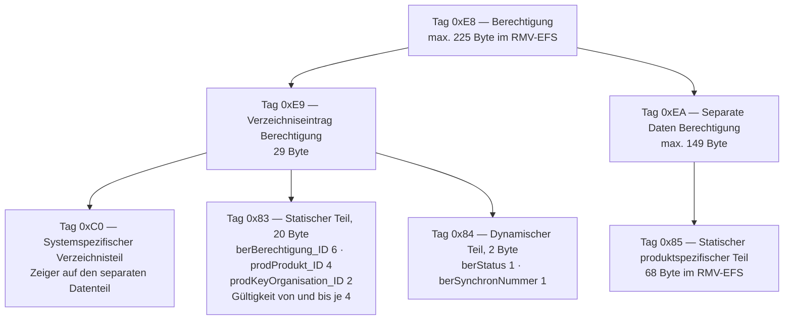

<!-- GEN:breadcrumb -->
[Home](../../README.md) › [Berechtigungen](../berechtigungen.md) › Berechtigung
<!-- /GEN:breadcrumb -->

# Berechtigung

„Eine Berechtigung basiert auf hinterlegten Daten, die zur Inanspruchnahme einer ÖPV-Leistung berechtigen. Eine Berechtigung besteht unter anderem aus einer **eindeutigen ID** und einem **Gültigkeitszeitraum**.“ ([Q02](../../QUELLEN.md#q02), S. 30)

Sie kann binär in einer chip-basierten oder emulierten Applikation hinterlegt sein, kopiergeschützt in einem Smartphone, als statischer Barcode auf Papier oder im Smartphone — oder **in einer Cloud**, auf die mit Hilfe einer eindeutigen ID zugegriffen wird ([Q02](../../QUELLEN.md#q02), S. 30).

In einer Applikation hinterlegte Daten liegen als [elektronischer Fahrschein](efs.md) oder als eBezahlberechtigung vor; bei den anderen Ausgabeformen ist **nur** ein elektronischer Fahrschein möglich ([Q02](../../QUELLEN.md#q02), S. 30).

Im RMV-EFS ist die Struktur bis auf die Byteebene festgelegt ([Q05](../../QUELLEN.md#q05), Kap. 2.1) · *verbundspezifisch*:

Die Teilung in **statisch** und **dynamisch** ist der Schlüssel: Produkt, Organisationen und Gültigkeit stehen fest, Status und Synchronnummer ändern sich im Lebenszyklus (abgeleitet).

## Einfach erklärt – Beispiel aus Bärstadt

Eine Berechtigung ist kein Dokument, sondern ein Datensatz — und er ist überraschend klein.

Pias ganzes ABO Azubi passt im RMV-Format in höchstens 225 Byte. Das ist weniger als dieser Absatz. Darin steckt alles: welche Berechtigung, welches Produkt, von wann bis wann, in welchem Zustand.

Der Aufbau ist wie bei russischen Puppen geschachtelt, und die Schachtelung hat einen Zweck. Ganz außen liegt die Berechtigung. Darin liegt ein **Verzeichniseintrag** — das ist der Teil, den ein Kontrollgerät zuerst liest, weil dort das Wesentliche steht. Daneben liegen die **separaten Daten** mit dem, was nur das jeweilige Produkt betrifft.

Die wichtigste Unterscheidung steckt im Verzeichniseintrag selbst, denn er ist zweigeteilt.

Im **statischen Teil** steht, was sich nie ändert: Pias Berechtigungsnummer, das Produkt 2001, die beteiligten Organisationen, und der Zeitraum vom 1. September 2026 bis zum 31. August 2029. Diese zwanzig Byte werden einmal geschrieben und dann nicht mehr angefasst.

Im **dynamischen Teil** stehen genau zwei Byte: der Zustand und ein Zähler. Das ist alles, was sich an einer Berechtigung im Laufe ihres Lebens ändern kann.

Das ist eine elegante Konstruktion. Wird Pias Abo gesperrt und später entsperrt, muss niemand die Gültigkeit oder das Produkt neu schreiben. Es ändert sich ein einziges Byte.

Und es erklärt, warum die Karte so sparsam mit Schreibvorgängen umgehen kann. Jeder Schreibvorgang auf einem Chip kostet Zeit und ist eine mögliche Fehlerquelle — in einer Straßenbahn, in der Pia die Karte eine Sekunde hinhält, zählt das.

## Quellen

- [Q02](../../QUELLEN.md#q02) – Glossar VDV-KA / etiCORE, S. 30 („Berechtigung / Entitlement“: wörtliche Definition, eindeutige ID und Gültigkeitszeitraum, Ablage binär in einer Applikation, kopiergeschützt im Smartphone, als statischer Barcode oder in einer Cloud; EFS oder eBezahlberechtigung in einer Applikation, sonst nur EFS)
- [Q05](../../QUELLEN.md#q05) – RMV PH 05-A1, Kap. 2.1 (PDF-S. 8 f.): vollständige TLV-Struktur „Berechtigung“ mit den Tags 0xE8, 0xE9, 0xC0, 0x83, 0x84, 0xEA und 0x85, den Längen und den Feldern samt Datentypen und MAC-Schlüsselreferenzen · *verbundspezifisch: eTicket RheinMain*

<!-- GEN:siehe_auch -->
## Siehe auch

- [Elektronischer Fahrschein](efs.md) (EFS)
- [berStatus](berstatus.md)
- [Produktspezifischer Teil](produktspezifischer-teil.md)
<!-- /GEN:siehe_auch -->

<!-- GEN:navigation -->
---

**Navigation:** [Home](../../README.md) · [Berechtigungen](../berechtigungen.md) · [Register](../../REGISTER.md)
<!-- /GEN:navigation -->
