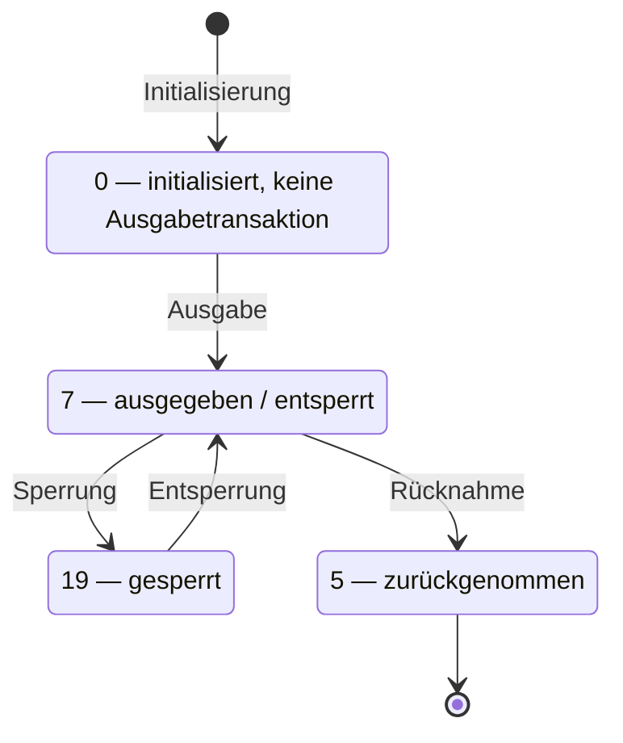

<!-- GEN:breadcrumb -->
[Home](../../README.md) › [Berechtigungen](../berechtigungen.md) › berStatus
<!-- /GEN:breadcrumb -->

# berStatus

`berStatus` steht im **dynamischen Teil** der Berechtigung, hat den Datentyp `INT1` mit **einem Byte** und nutzt die Codeliste **`WertobjektStatus_CODE`** ([Q05](../../QUELLEN.md#q05), Kap. 2.1). Diese Codeliste beschreibt den Status eines Wertobjekts der Kernapplikation, also einer Applikation, eines AFB oder eines EFS ([Q52](../../QUELLEN.md#q52), Tab. 6-91, S. 102).

Die Standardcodeliste hat **genau vier Werte**. Zu jedem nennt die Quelle die Entsprechung aus EN 1545-1:

| Wert | Bedeutung | EN 1545-1 |
|---:|---|---|
| **0** | keine Angabe / initialisiert / keine Ausgabetransaktion ausgeführt | never validated |
| **5** | zurückgenommen | canceled |
| **7** | ausgegeben / entsperrt | o.k. |
| **19** | gesperrt | blocked |

**Der Wert 8 gehört nicht dazu.** [Q05](../../QUELLEN.md#q05), Kap. 2.1, führt im eTicket RheinMain zusätzlich `8` = „Neu, aber noch nicht aktiv / New“. In der Standardcodeliste fehlt er; er ist eine Festlegung des Verbunds. Für den Zustand „ausgegeben, aber noch nicht genutzt“ führt der Standard die `0`.

Die **Zustände** sind belegt, die **Übergänge** sind aus den Aktionstypen und Transaktionstypcodes erschlossen (abgeleitet).

In etiCORE kennt `EntitlementStatusEnum` die Werte 5 (terminated), 7 (ok) und 19 (blocked) mit Verweis auf EN 1545-1:2015; die 8 fehlt dort ebenso ([Q51](../../QUELLEN.md#q51), Modul `user-medium`). Zwei Fassungen des Standards bestätigen damit unabhängig, dass die 8 nicht zur Normliste gehört.

Dass „neu“ einen höheren Code hat als „aktiv“, ist kein Widerspruch: Die Codes sind Zustandskennungen, keine Reihenfolge ([Q02](../../QUELLEN.md#q02) enthält keinen Eintrag „Berechtigungsstatus“).

## Einfach erklärt – Beispiel aus Bärstadt

Ein einziges Byte entscheidet darüber, ob Pia fahren darf.

Der Standard kennt vier Werte, und sie beschreiben Zustände, nicht Schritte. Das ist die wichtigste Einsicht, denn an dieser Stelle verrennt man sich leicht.

**0 heißt „noch nichts passiert“.** Die Berechtigung ist angelegt, aber es gibt keine Ausgabetransaktion dazu.
**7 heißt „ausgegeben und entsperrt“** — das ist der Normalzustand. Pias Abo trägt die 7.
**19 heißt „gesperrt“.** Nach ihrer Verlustmeldung stand ihr Abo auf 19.
**5 heißt „zurückgenommen“.** Das Ende.

Nun die Frage, die beim ersten Blick auf solche Listen immer kommt: Warum sind die Zahlen so krumm? Warum nicht 1, 2, 3, 4?

Weil die Zahlen keine Reihenfolge sind, sondern Namen. Dass 19 größer als 7 ist, bedeutet so wenig wie dass „Birne“ länger als „Apfel“ ist. Es sind Kennungen aus einer Liste, die aus einer europäischen Norm stammt und in der auch andere Wertobjekte ihre Zustände haben — deshalb die Lücken.

Diese Verwechslung ist ein klassischer Fehler beim Lesen solcher Nachrichten: Man sieht aufsteigende Zahlen und vermutet einen Ablauf. Hier gibt es keinen.

Was es stattdessen gibt, sind **Übergänge**. Von 7 nach 19 kommt man durch eine Sperrung, zurück nach 7 wieder durch eine Entsperrung. Von 7 nach 5 durch eine Rücknahme — und von dort gibt es keinen Weg zurück.

Und jetzt die Stelle, an der ein Prüfwerkzeug aufpassen muss. Im eTicket RheinMain gibt es einen fünften Wert: die **8** für „neu, aber noch nicht aktiv“. Im Standard kommt sie nicht vor. Wer eine Nachricht aus Bärstadt liest und dort eine 8 findet, hat also keinen Fehler vor sich, sondern eine Festlegung des Verbunds — und darf sie nicht nach dem Standard deuten. Umgekehrt: Wer ein Werkzeug baut, das nur den Standard kennt, wird die 8 für ungültig erklären und damit im falschen Moment Alarm schlagen.

Für denselben Gedanken — die Berechtigung ist da, aber noch nicht benutzt — hat der Standard die 0. Zwei Verbünde, zwei Zahlen, eine Bedeutung. Solche Stellen sind der Grund, warum in diesem Lexikon über jeder Codetabelle steht, aus welcher Liste sie kommt.

## Quellen

- [Q52](../../QUELLEN.md#q52) – KA HD_BOM-SPEC 1.12.0, Tab. 6-91 (S. 102): Codeliste `WertobjektStatus_CODE` mit genau vier Werten — 0 = keine Angabe / initialisiert / keine Ausgabetransaktion ausgeführt (EN 1545-1 never validated), 5 = zurückgenommen (canceled), 7 = ausgegeben/entsperrt (o.k.), 19 = gesperrt (blocked); Beschreibung „Status eines Wertobjekts der Kernapplikation“, Entsprechung `EN 1545: ProductStatus`. Exzerpt: [exzerpte/Q52.md](../../exzerpte/Q52.md) · *nicht öffentlich*
- [Q05](../../QUELLEN.md#q05) – RMV PH 05-A1, Kap. 2.1 (PDF-S. 9): `berStatus` im dynamischen Teil der Berechtigung, Datentyp `INT1` mit einem Byte, Codeliste `WertobjektStatus_CODE`; „relevante Werte“ 5, 7, 8 = Neu, aber noch nicht aktiv / New, 19 · *verbundspezifisch: eTicket RheinMain*
- [Q51](../../QUELLEN.md#q51) – etiCORE ASN.1 Data Type Description 3.0.0-rc.6, Modul `user-medium`: Typ `EntitlementStatusEnum` (Werte 5, 7, 19; EN 1545-1:2015 ProductStatus) · *Release-Kandidat*
- [Q02](../../QUELLEN.md#q02) – Glossar VDV-KA / etiCORE: **kein** Eintrag „Berechtigungsstatus“ (geprüft am Inhaltsverzeichnis, S. 2–13); S. 38 f. („Entsperrung“), S. 91 („Sperrung“)

<!-- GEN:siehe_auch -->
## Siehe auch

- [berSynchronNummer](bersynchronnummer.md)
- [Entsperrung über Aktionsliste](../aktionsmanagement/entsperrung-ueber-aktionsliste.md)
- [Gültigkeit](gueltigkeit.md)
- [Sperrung](../kontrolle/sperrung.md)
<!-- /GEN:siehe_auch -->

<!-- GEN:navigation -->
---

**Navigation:** [Home](../../README.md) · [Berechtigungen](../berechtigungen.md) · [Register](../../REGISTER.md)
<!-- /GEN:navigation -->
