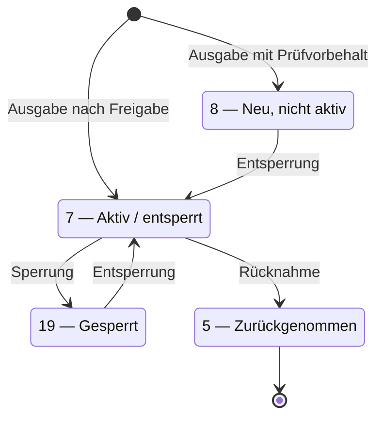

<!-- GEN:breadcrumb -->
[Home](../../README.md) › [Berechtigungen](../berechtigungen.md) › berStatus
<!-- /GEN:breadcrumb -->

# berStatus

`berStatus` steht im **dynamischen Teil** der Berechtigung, hat den Datentyp `INT1` mit **einem Byte** und nutzt die Codeliste **`WertobjektStatus_CODE`** ([Q05](../../QUELLEN.md#q05), Kap. 2.1).

Als „relevante Werte“ nennt [Q05](../../QUELLEN.md#q05), Kap. 2.1, vier Codes:

| Wert | Deutsch | Englisch |
|---:|---|---|
| **5** | Zurückgenommen | Cancelled |
| **7** | Aktiv / entsperrt | o.k. |
| **8** | Neu, aber noch nicht aktiv | New |
| **19** | Gesperrt | Blocked |

Die Übergänge sind aus den Aktionstypen und den Transaktionstypcodes erschlossen (abgeleitet), die Zustände selbst sind belegt.

**Zur Reichweite** (zu prüfen, O3): Die Werte stehen in einem Verbunddokument, aber die Formulierung „Codeliste `WertobjektStatus_CODE`, relevante Werte“ zeigt eine **Auswahl aus einer Standardcodeliste** — nicht eine eigene Festlegung. Dafür sprechen auch die englischen Bezeichnungen. Die Codeliste selbst steht in der nicht öffentlichen KA BOM-SPEC (abgeleitet).

Dass „neu“ (8) einen höheren Code hat als „aktiv“ (7), ist daher kein Widerspruch: Die Codes sind Zustandskennungen, keine Reihenfolge ([Q02](../../QUELLEN.md#q02) enthält keinen Eintrag „Berechtigungsstatus“).

## Einfach erklärt – Beispiel aus Bärstadt

Ein einziges Byte entscheidet darüber, ob Pia fahren darf.

Vier Werte sind in Gebrauch, und sie beschreiben Zustände, nicht Schritte. Das ist die wichtigste Einsicht, denn an dieser Stelle verrennt man sich leicht.

**8 heißt „neu, aber noch nicht aktiv“.** Die Berechtigung ist auf der Karte, gilt aber noch nicht.
**7 heißt „aktiv“** — das ist der Normalzustand. Pias Abo trägt die 7.
**19 heißt „gesperrt“.** Nach ihrer Verlustmeldung stand ihr Abo auf 19.
**5 heißt „zurückgenommen“.** Das Ende.

Nun die Frage, die beim ersten Blick auf diese Liste immer kommt: Warum hat „neu“ die höhere Zahl als „aktiv“? Müsste nicht neu vor aktiv kommen?

Nein — und der Gedanke führt in die Irre. Die Zahlen sind keine Reihenfolge, sondern Namen. Dass 8 größer als 7 ist, bedeutet so wenig wie dass „Birne“ länger als „Apfel“ ist. Es sind Kennungen aus einer Liste, in der auch andere Wertobjekte ihre Zustände haben.

Diese Verwechslung ist ein klassischer Fehler beim Lesen solcher Nachrichten: Man sieht aufsteigende Zahlen und vermutet einen Ablauf. Hier gibt es keinen.

Was es stattdessen gibt, sind **Übergänge**. Von 8 nach 7 kommt man durch eine Entsperrung. Von 7 nach 19 durch eine Sperrung, zurück nach 7 wieder durch eine Entsperrung. Von 7 nach 5 durch eine Rücknahme — und von dort gibt es keinen Weg zurück.

Eine Vorsicht bleibt: Diese vier Werte stehen in einem RMV-Dokument. Allerdings nennt es ausdrücklich eine **Codeliste des Standards** und wählt daraus die „relevanten Werte“ aus. Es sind also sehr wahrscheinlich keine RMV-Erfindungen. Sicher ist das erst mit der Standardcodeliste selbst.

## Quellen

- [Q05](../../QUELLEN.md#q05) – RMV PH 05-A1, Kap. 2.1 (PDF-S. 9): `berStatus` im dynamischen Teil der Berechtigung, Datentyp `INT1` mit einem Byte, Codeliste `WertobjektStatus_CODE`; „relevante Werte“ 5 = Zurückgenommen / Cancelled, 7 = Aktiv / entsperrt / o.k., 8 = Neu, aber noch nicht aktiv / New, 19 = Gesperrt / Blocked · *verbundspezifisch: eTicket RheinMain*
- [Q02](../../QUELLEN.md#q02) – Glossar VDV-KA / etiCORE: **kein** Eintrag „Berechtigungsstatus“ (geprüft am Inhaltsverzeichnis, S. 2–13); S. 38 f. („Entsperrung“), S. 91 („Sperrung“)

<!-- GEN:navigation -->
---

**Navigation:** [Home](../../README.md) · [Berechtigungen](../berechtigungen.md) · [Register](../../REGISTER.md)
<!-- /GEN:navigation -->
