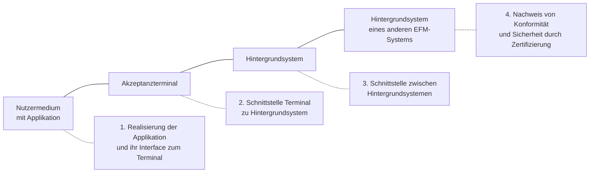

<!-- GEN:breadcrumb -->
[Home](../README.md) › Grundlagen
<!-- /GEN:breadcrumb -->

# Grundlagen

Diese Kategorie klärt, **was** die VDV-Kernapplikation ist, wie sie heißt, in welchen Versionen sie existiert und welche Teile ein Teilnehmer überhaupt umsetzen muss.

Der Name **Kernapplikation (KA)** steht für den deutschlandweiten Standard für elektronische Fahrgeldmanagementsysteme bei unterschiedlichen ÖPV- oder Systembetreibern **in der Version 1 und 2**; der neue Name **etiCORE** bezieht sich auf **Version 3** ([Q02](../QUELLEN.md#q02), S. 51).

Der Standard umfasst Sicherheit, Zertifizierung, Organisationskonzept und Systemschnittstellen und definiert vier Dinge ([Q02](../QUELLEN.md#q02), S. 51):

Die Reihenfolge ist kein Zufall: Der Standard arbeitet sich vom Medium über das Terminal und das eigene Hintergrundsystem bis zu fremden Systemen vor — und sichert das Ganze durch ein Zertifizierungsverfahren ab.

Darüber steht das **elektronische Fahrgeldmanagement (EFM)** als Oberbegriff für alle Maßnahmen rund um das elektronische Ticketing ([Q02](../QUELLEN.md#q02), S. 36 f.). Die KA ist also nicht das EFM, sondern der Standard, mit dem EFM-Systeme interoperabel werden.

Welche Teile ein Teilnehmer umsetzt, legen die **Ausbauvarianten** fest ([Q25](../QUELLEN.md#q25), Anlage 2).

## Einfach erklärt – Beispiel aus Bärstadt

Bevor es um Nachrichten, Rollen und Codelisten geht, lohnt eine Einordnung: Was ist die VDV-Kernapplikation eigentlich?

Sie ist kein Produkt. Niemand kauft „eine Kernapplikation“. Sie ist ein **Regelwerk** — eine Sammlung von Festlegungen, damit Geräte und Rechenzentren verschiedener Unternehmen miteinander auskommen.

Der Vergleich mit einer Steckdose trifft es gut. Eine Norm für Steckdosen beschreibt nicht den Staubsauger und nicht das Kraftwerk. Sie beschreibt die Stelle, an der beide zusammenkommen — und zwar so genau, dass ein Gerät aus Bärstadt auch in Luchsstadt funktioniert.

Genau diese Stellen definiert die Kernapplikation, und zwar vier davon. Erstens: Was liegt auf Pias BärenKarte, und wie spricht ein Gerät mit ihr? Zweitens: Wie redet das Lesegerät am Hauptbahnhof mit dem Rechenzentrum der Bärstädter Verkehrsbetriebe? Drittens: Wie reden die Rechenzentren verschiedener Unternehmen miteinander, etwa das der BVB mit dem des Bären-Verkehrsbunds? Und viertens: Wie beweist ein Hersteller, dass sein Gerät sich an die Regeln hält?

Der vierte Punkt wird leicht übersehen, ist aber der, der das Ganze zusammenhält. Ein Standard, an den sich jeder halten könnte, es aber niemand prüft, ist eine Empfehlung. Erst die Zertifizierung macht daraus eine Zusage.

Beim Namen ist Vorsicht geboten: „Kernapplikation“ meint die Versionen 1 und 2. Ab Version 3 heißt dasselbe System **etiCORE** — das ist keine Ablösung durch etwas anderes, sondern eine Umbenennung mit neuer Technikgeneration.

Und noch eine Abgrenzung, die im Alltag oft verrutscht: Das **elektronische Fahrgeldmanagement** ist der Oberbegriff für alles rund um elektronisches Ticketing. Die Kernapplikation ist nur der Standard darin.

## Quellen

- [Q02](../QUELLEN.md#q02) – Glossar VDV-KA / etiCORE, S. 51 („Kernapplikation / etiCORE“: deutschlandweiter Standard in Version 1 und 2, etiCORE für Version 3, Umfang und die vier Definitionsbereiche; Abkürzung KA), S. 36 f. („Elektronisches Fahrgeldmanagement“ als Oberbegriff)
- [Q25](../QUELLEN.md#q25) – eTicket-Regelwerk, Kap. 3 (Verzeichnis der Spezifikationen), Kap. 4 (Markenbuch), Anlage 2 (Ausbauvarianten)

<!-- GEN:unterartikel -->
## Unterartikel

- [Ausbauvarianten](grundlagen/ausbauvarianten.md)
- [Elektronisches Fahrgeldmanagement](grundlagen/efm.md)
- [Elementarprozess](grundlagen/elementarprozess.md)
- [eTicket Deutschland](grundlagen/eticket-deutschland.md)
- [Interoperabilität](grundlagen/interoperabilitaet.md)
- [KA-Spezifikationen](grundlagen/ka-spezifikationen.md)
- [VDV-Kernapplikation](grundlagen/vdv-kernapplikation.md)
- [Versionen](grundlagen/versionen.md)
<!-- /GEN:unterartikel -->

<!-- GEN:siehe_auch -->
## Siehe auch

- [Rollen](rollen.md)
<!-- /GEN:siehe_auch -->

<!-- GEN:navigation -->
---

**Navigation:** [Home](../README.md) · [Register](../REGISTER.md)
<!-- /GEN:navigation -->
