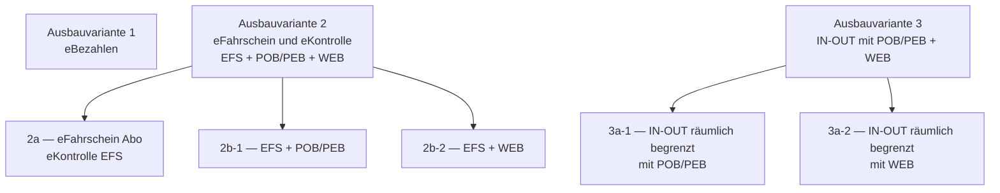

<!-- GEN:breadcrumb -->
[Home](../../README.md) › [Grundlagen](../grundlagen.md) › Ausbauvarianten
<!-- /GEN:breadcrumb -->

# Ausbauvarianten

Die Ausbauvarianten legen fest, **welchen Funktionsumfang** ein Teilnehmer umsetzt. Sie entstehen aus den Vollausbauvarianten der KA KUSCH-Spec zusammen mit den Migrationsregelungen; jede zulässige Migrationsregelung ist einer Vollausbauvariante zugeordnet und durch eine Erweiterung der Nummerierung gekennzeichnet ([Q25](../../QUELLEN.md#q25), Anlage 2, PDF-S. 158).

Zu einzelnen Varianten lassen sich **optionale Ergänzungen** zuwählen ([Q25](../../QUELLEN.md#q25), Anlage 2, PDF-S. 158):

| Ergänzung | Zulässig zu |
|---|---|
| Multiberechtigungen (MultiBER) | nur zu 2, 2a, 2b-1, 2b-2 |
| **[Aktionsmanagement](../aktionsmanagement.md) (AktM)** | nur zu 2, 2a, 2b-1, 2b-2 |
| Produkt- und Kontrollmodule (PKM) | zu allen Varianten |
| Statische Berechtigung, VDV-Barcode (STB) | auch als „autarke Lösung“ beim Handy- oder Onlineticket |
| tarifliche Besonderheiten | — |

Die Anwendungsfälle werden je Variante in **funktionsorientierten Paketen** zusammengefasst, die gemeinsam ein funktionsfähiges System oder eine Systemkomponente beschreiben ([Q25](../../QUELLEN.md#q25), Anlage 2, PDF-S. 158).

Die Dreiteilung entspricht den **Stufen des [EFM](efm.md)** — eBezahlen, elektronischer Fahrschein, automatisierte Fahrpreisermittlung ([Q02](../../QUELLEN.md#q02), S. 36 f.) (abgeleitet).

## Einfach erklärt – Beispiel aus Bärstadt

Niemand setzt die VDV-Kernapplikation vollständig um. Das ist kein Mangel, sondern vorgesehen.

Ein Verkehrsunternehmen wählt aus, was es braucht, und zwar nicht beliebig, sondern aus einem festen Katalog. Diese Pakete heißen Ausbauvarianten, und es gibt drei Hauptrichtungen.

**Variante 1 ist elektronisches Bezahlen** — die Karte als Geldbörse. Kein Fahrschein auf dem Chip, nur Guthaben.

**Variante 2 ist der elektronische Fahrschein.** Das ist Pias Welt: Das ABO Azubi liegt als Datenstruktur auf ihrer BärenKarte, und bei der Kontrolle liest Petra Pranke es aus. Bärstadt hat die Unterform 2a gewählt, den eFahrschein für Abonnements.

**Variante 3 ist IN-OUT** — Check-in und Check-out, bei dem der Preis aus der gefahrenen Strecke entsteht. Davon ist Bärstadt weit entfernt.

Interessant ist, was man **dazuwählen** kann, und wo die Grenzen liegen. Das Aktionsmanagement — also der ganze Mechanismus mit Aktionslisten, über den Pias Abo auf die Karte kommt — ist eine **optionale Ergänzung**, und sie ist nur zu Variante 2 und ihren Unterformen zulässig. Nicht zu Variante 1, nicht zu Variante 3.

Das erklärt rückblickend eine Menge. Wer nur elektronisches Bezahlen anbietet, braucht keine Aktionsliste, weil es keine Berechtigung gibt, die man auf eine Karte schreiben müsste. Und wer Check-in/Check-out betreibt, löst dasselbe Problem anders.

Für die Bärstädter Verkehrsbetriebe heißt das konkret: Sie haben Variante 2a gewählt und das Aktionsmanagement dazugewählt. Hätten sie es nicht getan, müsste Pia ihr Abo im Kundencenter direkt auf die Karte schreiben lassen — und könnte nicht einfach irgendwann am Hauptbahnhof vorbeikommen.

## Quellen

- [Q25](../../QUELLEN.md#q25) – eTicket-Regelwerk, Anlage 2 „KA Migrationsszenarien“ V1.6.0, PDF-S. 158 (Anlagenseite 15): Herleitung der Ausbauvarianten aus den Vollausbauvarianten der KA KUSCH-Spec und den Migrationsregelungen; vollständige Liste der Varianten 1, 2, 2a, 2b-1, 2b-2, 3, 3a-1, 3a-2; optionale Ergänzungen MultiBER, AktM, PKM, STB/VDV-Barcode und tarifliche Besonderheiten samt Zulässigkeit; Zusammenfassung der Anwendungsfälle in funktionsorientierten Paketen
- [Q02](../../QUELLEN.md#q02) – Glossar VDV-KA / etiCORE, S. 36 f. (die drei Stufen des EFM)

<!-- GEN:siehe_auch -->
## Siehe auch

- [Elektronisches Fahrgeldmanagement](efm.md) (EFM)
- [Aktionsmanagement](../aktionsmanagement.md) (AktM)
- [Elementarprozess](elementarprozess.md) (EP)
<!-- /GEN:siehe_auch -->

<!-- GEN:navigation -->
---

**Navigation:** [Home](../../README.md) · [Grundlagen](../grundlagen.md) · [Register](../../REGISTER.md)
<!-- /GEN:navigation -->
