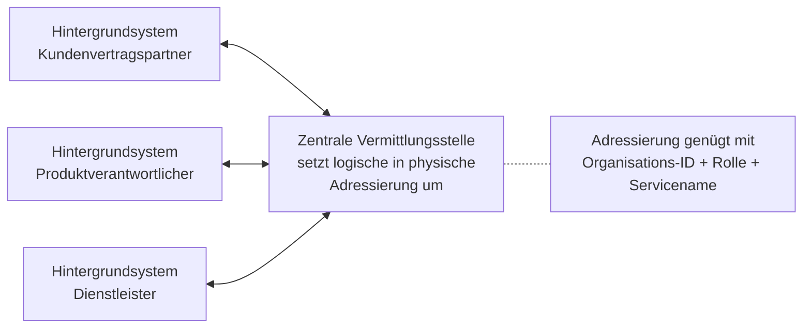

<!-- GEN:breadcrumb -->
[Home](../../README.md) › [Grundlagen](../grundlagen.md) › Interoperabilität
<!-- /GEN:breadcrumb -->

# Interoperabilität

Allgemein ist Interoperabilität „ein Merkmal eines Produkts oder Systems, dessen Schnittstellen vollständig bekannt sind, so dass es mit anderen gegenwärtigen oder zukünftigen Produkten oder Systemen ohne irgendwelche Einschränkungen zusammenarbeiten kann“ ([Q02](../../QUELLEN.md#q02), S. 48).

Innerhalb von eTicket Deutschland ist sie konkreter definiert: die **Gewährleistung sowohl einer durchgehenden Reise als auch punktueller Einzelfahrten für den Fahrgast unter Benutzung desselben Nutzermediums mit derselben Applikation** in den Netzwerken der vertraglich eingebundenen Verkehrsunternehmen. Das gilt auch für Smartphone-Apps, die mit dem MOTICS-Standard arbeiten ([Q02](../../QUELLEN.md#q02), S. 48 f.).

Technisch getragen wird das vom **Interoperabilitätsnetzwerk (ION)**: Es ermöglicht den interoperablen und sicheren Nachrichtenaustausch zwischen Teilnehmersystemen, definiert Nachrichtenformat und Adressierung und setzt standardisierte Sicherheitsmechanismen für Transport- und Nachrichtensicherheit sowie festgelegte Sende- und Empfangsabläufe samt Fehlerszenarien ein ([Q02](../../QUELLEN.md#q02), S. 49).

Das ION umfasst die **Zentrale Vermittlungsstelle**, die die logische Adressierung in eine physische umsetzt und Nachrichten ausliefert oder zwischenspeichert ([Q02](../../QUELLEN.md#q02), S. 49):

Damit können die Hintergrundsysteme von Applikationsherausgeber, Sperrlistenservice, Produktverantwortlichem, Kundenvertragspartner und Dienstleister **auf gleiche Weise** miteinander kommunizieren: Sie benötigen nur Organisations-ID, Rolle und Servicenamen des Partners und müssen gemäß ION-Spezifikation angeschlossen sein ([Q02](../../QUELLEN.md#q02), S. 49).

Das ist der Grund, weshalb [Organisations-ID](../rollen/organisations-id.md) und Rollencode in jeder Nachricht stehen.

## Einfach erklärt – Beispiel aus Bärstadt

Interoperabilität ist das Versprechen, das die ganze Kernapplikation rechtfertigt: eine Karte, viele Unternehmen.

Pia Brummbär fährt morgens mit der Linie 4 zur Berufsschule — Bärstädter Verkehrsbetriebe. Am Wochenende fährt sie mit der Regionalbahn nach Luchsstadt, einem anderen Verbund mit anderen Unternehmen. Sie nimmt beide Male dieselbe BärenKarte.

Dass das funktioniert, ist keine Selbstverständlichkeit. Die Systeme in Bärstadt und Luchsstadt wurden von verschiedenen Herstellern gebaut, zu verschiedenen Zeiten, für verschiedene Auftraggeber. Sie haben sich nie abgesprochen.

Möglich wird es durch eine Idee, die man von der Post kennt. Niemand muss wissen, wie Briefe sortiert werden oder welche Straße der Zusteller nimmt. Man braucht nur eine Adresse.

Genauso funktioniert das Interoperabilitätsnetzwerk. Will das Rechenzentrum der BVB eine Nachricht an den Bären-Verkehrsbund schicken, braucht es genau drei Angaben: die **Organisations-ID** des Empfängers, seine **Rolle** und den **Namen des Dienstes**. Wo dieses System steht, welche IP-Adresse es hat, welcher Hersteller es gebaut hat — all das muss die BVB nicht wissen.

Dafür gibt es in der Mitte eine Vermittlungsstelle. Sie übersetzt die logische Adresse — „9020, Rolle Produktverantwortlicher“ — in die technische und liefert aus. Ist der Empfänger gerade nicht erreichbar, hält sie die Nachricht zwischen.

Damit erklärt sich auch rückblickend eine Eigenheit, über die man beim Lesen von Nachrichten stolpert: Warum steht in jedem Briefkopf eine Organisations-ID **und** ein Rollencode? Weil genau das die Adresse ist. Ohne beide könnte die Vermittlungsstelle nicht zustellen.

## Quellen

- [Q02](../../QUELLEN.md#q02) – Glossar VDV-KA / etiCORE, S. 48 f. („Interoperabilität“: allgemeine Definition und die Definition innerhalb von eTicket Deutschland samt Hinweis auf MOTICS-Apps), S. 49 („Interoperabilitätsnetzwerk“: Nachrichtenformat und Adressierung, standardisierte Sicherheitsmechanismen, Sende- und Empfangsabläufe, Fehlerszenarien, Zentrale Vermittlungsstelle mit Umsetzung logischer in physische Adressierung, Adressierung über Organisations-ID, Rolle und Servicename), S. 99 („Zentrale Vermittlungsstelle“)
- [Q25](../../QUELLEN.md#q25) – eTicket-Regelwerk, Kap. 3 (KA ION-SPEC als Inventarnummer 9, KA IONA-Spec als Inventarnummer 39)

<!-- GEN:siehe_auch -->
## Siehe auch

- [Organisations-ID](../rollen/organisations-id.md) (Org-ID)
- [Transaktionen](../transaktionen.md)
- [eTicket Deutschland](eticket-deutschland.md)
<!-- /GEN:siehe_auch -->

<!-- GEN:navigation -->
---

**Navigation:** [Home](../../README.md) · [Grundlagen](../grundlagen.md) · [Register](../../REGISTER.md)
<!-- /GEN:navigation -->
