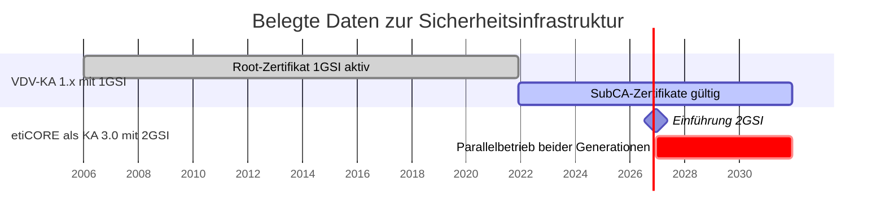

<!-- GEN:breadcrumb -->
[Home](../../README.md) › [Grundlagen](../grundlagen.md) › Versionen
<!-- /GEN:breadcrumb -->

# Versionen

**Version und Release sind zwei Ebenen.** Das eTicket-Regelwerk unterscheidet sie klar ([Q25](../../QUELLEN.md#q25), Kap. 4.3.1.3 f.):

- Es werden **nur zwei Versionen gleichzeitig unterstützt**; mit Einführung einer neuen Version entfällt die älteste.
- **Innerhalb einer Version sind die Releases hinsichtlich des gemeinsamen Namensraumes kompatibel.** Ein System mit höherem Release kann mit einem niedrigeren Release Transaktionen austauschen, soweit die Operationen dort definiert sind.
- Die Releasenummer ist verbindlich für **alle** zugehörigen Komponenten — WSDLs, XSDs, Spezifikationen — und wird durchgehend verwendet. Ein neues Release bringt stets überarbeitete Spezifikationspakete, Servicevereinbarungen, Datenstrukturen, Schnittstellendokumentation und Release Notes.

**Die Versionen:** Kernapplikation ist der Name für **Version 1 und 2**, etiCORE für **Version 3** ([Q02](../../QUELLEN.md#q02), S. 51). Die Releasehistorie des Glossars zeigt die Übergangsphase mit Doppelnummerierung, etwa „1.9.0/3.0.0“ und „1.10/3.0.0-rc.1 — Added etiCORE as Name for the new Version KA 3“ ([Q02](../../QUELLEN.md#q02), S. 2).

**Die Releases**, soweit belegt: 1.1.07 und 1.3.0 werden in den Projektdokumenten als `*_1107` und `*_1300` unterschieden ([Q06](../../QUELLEN.md#q06), Kap. 2.1.5); zu 1.5.0 existiert nur eine Sekundärquelle ([Q29](../../QUELLEN.md#q29), zu prüfen); ein Zulassungs-Prüfbericht von 2024 führt zwölf Spezifikationen in **1.12.0** ([Q37](../../QUELLEN.md#q37)). Welches Release heute verbindlich ist, ist von außen nicht erkennbar.

**Die Zeitschiene** der Sicherheitsgenerationen ([Q42](../../QUELLEN.md#q42), [Q02](../../QUELLEN.md#q02), S. 14 f.):

Für die Zuordnung eines Namensraums zu einem Release siehe [`txalisber`](../transaktionen/txalisber.md) (zu prüfen, O4).

## Einfach erklärt – Beispiel aus Bärstadt

Bei den Versionsnummern der VDV-KA stolpert man leicht, weil zwei Zählungen übereinanderliegen.

Die eine ist die **Version**: eine einzelne Zahl. Version 1 und 2 heißen Kernapplikation, Version 3 heißt etiCORE. Mehr Versionen gibt es nicht gleichzeitig — genauer gesagt immer nur zwei, und wenn eine neue kommt, fällt die älteste weg.

Die andere ist das **Release**: die ausführliche Nummer wie 1.1.07, 1.3.0 oder 1.12.0. Releases sind Ausbaustufen innerhalb einer Version. Und hier liegt die praktisch wichtigste Regel: Innerhalb einer Version bleiben die Releases **kompatibel**. Ein neueres System kann mit einem älteren reden, es darf nur keine Funktionen verlangen, die das alte nicht kennt.

Für Bärstadt heißt das: Wenn die Bärstädter Verkehrsbetriebe ihr System modernisieren, müssen nicht alle Partner gleichzeitig nachziehen. Solange man innerhalb derselben Version bleibt, verstehen sich alle weiterhin.

Die Zeitachse ist derzeit besonders interessant, denn es passiert gerade etwas. Das Wurzelzertifikat der ersten Sicherheitsgeneration ist schon seit Dezember 2021 abgelaufen — nicht die bestehenden Zertifikate, nur die Möglichkeit, neue damit auszustellen. Die bestehenden laufen noch bis Dezember 2031.

Und zum **1. Dezember 2026** startet die nächste Generation: etiCORE als Version 3. Von da an laufen fünf Jahre lang beide Welten parallel, bis 2031. Wer heute ein System baut, baut es also in eine Übergangsphase hinein.

Ein Rat aus dieser Konstellation: Die Nachrichtenverarbeitung von Anfang an versionsabhängig anlegen. Ein Werkzeug, das nur ein Release kennt, ist in einem Fünfjahres-Parallelbetrieb wenig wert.

## Quellen

- [Q25](../../QUELLEN.md#q25) – eTicket-Regelwerk, Kap. 4.3.1.2 (Inhalt eines neuen Releases, Verbindlichkeit der Releasenummer für alle Komponenten), Kap. 4.3.1.3 (nur zwei Versionen gleichzeitig), Kap. 4.3.1.4 (Kompatibilität der Releases innerhalb einer Version über den gemeinsamen Namensraum, mit Beispiel)
- [Q02](../../QUELLEN.md#q02) – Glossar VDV-KA / etiCORE, S. 51 (Version 1 und 2 als KA, Version 3 als etiCORE), S. 2 (Releasehistorie des Glossars mit Doppelnummerierung „1.9.0/3.0.0“ und „1.10/3.0.0-rc.1 — Added etiCORE as Name for the new Version KA 3“), S. 14 f. (1GSI mit Algorithmen, Schlüsseln und PKI im Format von 2006; 2GSI ab 2026)
- [Q37](../../QUELLEN.md#q37) – cetecom-Prüfbericht (2024), S. 4 (zwölf Spezifikationen in Version 1.12.0)
- [Q42](../../QUELLEN.md#q42) – KCD NRW, Newsletterarchiv (Root-Zertifikat 1GSI bis 01.12.2021, SubCA-Zertifikate bis 01.12.2031, etiCORE als KA 3.0 zum 01.12.2026, Parallelbetrieb 2026–2031) · *Sekundärquelle*
- [Q29](../../QUELLEN.md#q29) – itcs-info, Release 1.5.0 · *Sekundärquelle, zu prüfen*
- [Q06](../../QUELLEN.md#q06) – RMV PH 06-02, Kap. 2.1.5 (Unterscheidung `*_1107` und `*_1300`) · *verbundspezifisch*

<!-- GEN:navigation -->
---

**Navigation:** [Home](../../README.md) · [Grundlagen](../grundlagen.md) · [Register](../../REGISTER.md)
<!-- /GEN:navigation -->
