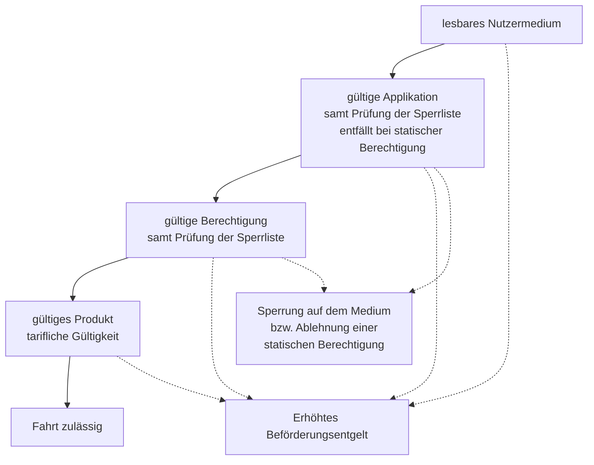

<!-- GEN:breadcrumb -->
[Home](../README.md) › Kontrolle
<!-- /GEN:breadcrumb -->

# Kontrolle

Die Kontrolle prüft, dass der Kunde **alle nötigen Voraussetzungen** für die Nutzung einer ÖPV-Leistung hat ([Q02](../QUELLEN.md#q02), S. 52):

Liegt eine Voraussetzung nicht vor, initiiert die Kontrolle das **Erhöhte Beförderungsentgelt**. Werden Sperreinträge gefunden, initiiert sie zusätzlich eine **Sperrung** auf dem Kundenmedium oder lehnt eine statische Berechtigung ab ([Q02](../QUELLEN.md#q02), S. 52 f.).

Die Kontrolle liegt vorrangig im **Interesse des Dienstleisters**, der seine Leistungen auf Grundlage von Leistungsnachweisen gegenüber den Kundenvertragspartnern abrechnet ([Q02](../QUELLEN.md#q02), S. 53).

Ein aktuelles Branchendokument gliedert den Begriff in **zwei Aspekte** ([Q33](../QUELLEN.md#q33), Kap. 4) · *verbundspezifisch bzw. produktbezogen*: die **tarifliche Prüfung** (räumlich, zeitlich, Personenbezug, Verkehrsmittel, Serviceklasse) und die **Prüfung auf Betrug und missbräuchliche Nutzung** (stornierte oder erstattete Tickets, Kauf nach einem EBE, gekündigte Tickets).

**Versionsunterschied:** In 1GSI / KA 1.X wird ein Kontrollnachweis zusätzlich zum Senden an den Produktverantwortlichen **auf das Nutzermedium geschrieben**; ab 2GSI / etiCORE geht er nur noch an den Produktverantwortlichen — damit ist die **Kontrolle ohne SAM** möglich ([Q02](../QUELLEN.md#q02), S. 53).

## Einfach erklärt – Beispiel aus Bärstadt

Wenn Petra Pranke in der Linie 4 Pias Karte prüft, läuft eine Kette von vier Fragen ab — und jede kann die Fahrt beenden.

**Ist das Medium lesbar?** Ist der Chip defekt, kommt man nicht weiter. Für Pia wäre das bitter, denn ihr Abo ist einwandfrei bezahlt — nur eben nicht nachweisbar.

**Ist die Applikation gültig und nicht gesperrt?** Hier wird die Karte als Ganzes geprüft. Nach Pias Verlustmeldung stand ihre Karte auf der Sperrliste; wäre sie damit gefahren, hätte Petra es gesehen.

**Ist die Berechtigung gültig und nicht gesperrt?** Jetzt geht es um das Abo selbst — Gültigkeitszeitraum, Status, und wieder die Sperrliste.

**Ist das Produkt tariflich gültig?** Gilt das ABO Azubi auf dieser Linie, in dieser Zone, in diesem Verkehrsmittel?

Scheitert eine dieser Fragen, entsteht ein erhöhtes Beförderungsentgelt. Findet Petra einen Sperreintrag, passiert noch mehr: Das Gerät sperrt die Karte **physisch**, schreibt also einen Sperrvermerk auf den Chip. Die Sperre reist danach mit der Karte und wirkt auch an Geräten, die die Liste noch nicht haben.

Ein aktuelles Branchenpapier teilt die Kontrolle in zwei Arten von Fragen, und diese Zweiteilung ist hilfreich. **Tariflich** fragt man: Darf diese Person hier fahren? **Gegen Betrug** fragt man: Ist mit diesem Ticket alles in Ordnung? Also: wurde es nach einer Kontrolle nachgekauft, wurde es storniert, wurde es gekündigt?

Interessant ist der Blick nach vorn. Heute schreibt das Kontrollgerät einen Nachweis auf die Karte — dafür braucht es einen Sicherheitsbaustein. In der nächsten Generation entfällt das, der Nachweis geht nur noch ans Backend. Dann kann man mit einem gewöhnlichen Smartphone kontrollieren.

## Quellen

- [Q02](../QUELLEN.md#q02) – Glossar VDV-KA / etiCORE, S. 52 f. („Kontrolle / Inspection“: die vier Voraussetzungen lesbares Nutzermedium, gültige Applikation samt Sperrlistenprüfung, gültige Berechtigung samt Sperrlistenprüfung und gültiges Produkt; Interesse des Dienstleisters und Abrechnung über Leistungsnachweise; Einleitung des Erhöhten Beförderungsentgelts; Sperrung bzw. Ablehnung bei Sperreinträgen; Sperren ohne SAM ab 2GSI; Kontrollnachweis auf dem Nutzermedium in 1GSI gegenüber nur an den PV ab 2GSI; Kontrolle als eigenständiger Anwendungsfall im Sinne der ISO 24014)
- [Q33](../QUELLEN.md#q33) – KCD NRW, Ergebnisdokument der Arbeitsgruppe Kontrolle, V1.3 (25.06.2024), Kap. 4 (zwei Aspekte der Kontrolle; Kap. 4.1 tarifliche Prüfung mit räumlicher und zeitlicher Gültigkeit, Personenbezug, Verkehrsmittel und Serviceklasse; Kap. 4.2 Prüfung auf Betrug und missbräuchliche Nutzung mit stornierten bzw. erstatteten Tickets, Kauf nach EBE und gekündigten Tickets) · *produktbezogen auf das Deutschlandticket*
- [Q06](../QUELLEN.md#q06) – RMV PH 06-02, Kap. 4.2.3 (Kontrollnachweise), Kap. 5.1 (Durchführung der Kontrolltransaktion) · *verbundspezifisch*

<!-- GEN:unterartikel -->
## Unterartikel

- [Entwertung](kontrolle/entwertung.md)
- [Fehlercodes des Hotlist Service](kontrolle/fehlercodes-des-hotlist-service.md)
- [Hotlist Service](kontrolle/hotlist-service.md)
- [Kontrollgerät](kontrolle/kontrollgeraet.md)
- [Kontrollnachweise](kontrolle/kontrollnachweise.md)
- [Sichtkontrolle](kontrolle/sichtkontrolle.md)
- [Sperranforderung](kontrolle/sperranforderung.md)
- [Sperrgrund](kontrolle/sperrgrund.md)
- [Sperrliste](kontrolle/sperrliste.md)
- [Sperrlisteneintrag](kontrolle/sperrlisteneintrag.md)
- [Sperrnachweis](kontrolle/sperrnachweis.md)
- [Sperrung](kontrolle/sperrung.md)
<!-- /GEN:unterartikel -->

<!-- GEN:siehe_auch -->
## Siehe auch

- [Kontroll- und Sperrlistenservice](rollen/kose.md) (KOSE)
- [Nachweis](transaktionen/nachweis.md)
- [Kontrollnachweise](kontrolle/kontrollnachweise.md)
- [Gültigkeit](berechtigungen/gueltigkeit.md)
<!-- /GEN:siehe_auch -->

<!-- GEN:navigation -->
---

**Navigation:** [Home](../README.md) · [Register](../REGISTER.md)
<!-- /GEN:navigation -->
