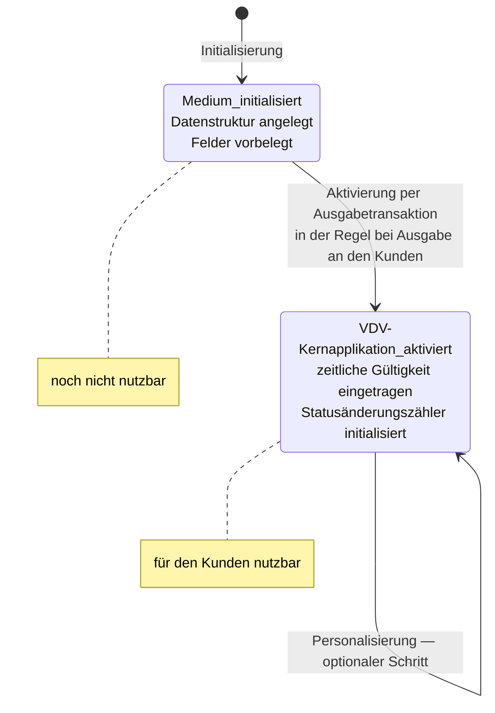

<!-- GEN:breadcrumb -->
[Home](../../README.md) › [Medien](../medien.md) › Lebenszyklus der Applikation
<!-- /GEN:breadcrumb -->

# Lebenszyklus der Applikation

Eine Applikation ist nach dem Anlegen **noch nicht nutzbar**. Sie durchläuft mehrere Stationen, die das Glossar als eigene Begriffe führt.

**Initialisierung.** Sie „legt die für die Applikation definierte Datenstruktur auf dem Chip an und füllt Datenfelder mit vordefinierten Werten“. Der Applikationsstatus erhält den logischen Wert „Medium_initialisiert“. „Die Applikation ist in diesem Zustand noch nicht nutzbar. Sie muss dazu aktiviert werden.“ ([Q02](../../QUELLEN.md#q02), S. 46 f.)

**Ausgabe.** Es kann mehrere Stellen geben, die vom Applikationsherausgeber berechtigt sind, die Applikation auf einem Nutzermedium anzulegen und/oder für die Nutzung zu aktivieren; die Ausgabe kann über den Vertrieb erfolgen und **erfolgt immer über einen [Kundenvertragspartner](../rollen/kvp.md)** ([Q02](../../QUELLEN.md#q02), S. 27).

**Aktivierung.** Sie erfolgt „in der Regel direkt im Zusammenhang mit der Ausgabe des Nutzermediums an den Kunden“. Mit einer **Ausgabetransaktion** wird der Status auf „VDV-Kernapplikation_aktiviert“ gesetzt, eine zeitliche Gültigkeit eingetragen und der **Statusänderungszähler** initialisiert ([Q02](../../QUELLEN.md#q02), S. 17).

**Personalisierung** bedeutet das Aufbringen personengebundener Daten in die Applikation; in der KA entstehen dabei ein Kundenprofil und ggf. Kundenpräferenzen ([Q02](../../QUELLEN.md#q02), S. 70).

**In etiCORE heißen zwei Schritte anders:** Die Initialisierung heißt **Individualisierung** (Status `INDIVIDUALISED`), die Aktivierung heißt **Konfiguration** (Status `CONFIGURED`) und kann bereits beim Kartenhersteller erfolgen ([Q02](../../QUELLEN.md#q02), S. 17, S. 46 f.).

## Einfach erklärt – Beispiel aus Bärstadt

Eine neue BärenKarte ist nicht einfach fertig. Sie wird in drei Schritten zu dem, was Pia benutzen kann.

**Schritt eins: die Datenstruktur anlegen.** Ein leerer Chip bekommt die Felder, die eine KA-Applikation braucht — mit Vorbelegungen, aber ohne Inhalt. Die Karte hat jetzt die richtige Form und ist ausdrücklich **noch nicht nutzbar**. Würde Pia sie an das Lesegerät halten, passierte nichts Sinnvolles.

**Schritt zwei: die Ausgabe.** Die Karte wandert zu Pia, über das Kundencenter am Honigmarkt. Interessant ist dabei eine Festlegung des Standards: Die Ausgabe erfolgt **immer über einen Kundenvertragspartner**. Es gibt keinen Weg, auf dem eine Karte ohne eine solche Stelle zum Kunden kommt — denn irgendwer muss die Kundenbeziehung tragen.

**Schritt drei: die Aktivierung.** Erst jetzt wird die Karte scharf gestellt, und zwar meist im selben Moment wie die Ausgabe. Dabei passieren drei Dinge gleichzeitig: Der Status wechselt auf „aktiviert", eine Gültigkeitsdauer wird eingetragen, und ein Zähler für Statusänderungen wird auf Anfang gesetzt.

Dieser Zähler ist eine schöne Kleinigkeit. Von nun an lässt sich nachvollziehen, wie oft der Zustand der Karte verändert wurde — nicht *was* geändert wurde, aber *wie oft*.

Die **Personalisierung** ist davon getrennt und optional. Erst sie bringt Pias Name auf die Karte. Eine Karte kann also aktiv und nutzbar sein, ohne personalisiert zu sein — genau so funktionieren anonyme Karten für Gelegenheitsfahrer.

Ein Hinweis fürs Lesen älterer und neuerer Unterlagen: In der neuen Generation heißen zwei dieser Schritte anders. Aus Initialisierung wird **Individualisierung**, aus Aktivierung wird **Konfiguration** — und letztere darf dann schon beim Kartenhersteller geschehen.

## Quellen

- [Q02](../../QUELLEN.md#q02) – Glossar VDV-KA / etiCORE, S. 46 f. („Initialisierung der NM-Applikation“: Anlegen der Datenstruktur, Vorbelegung der Felder, Status „Medium_initialisiert“, noch nicht nutzbar; in etiCORE Individualisierung mit Status `INDIVIDUALISED`), S. 27 („Ausgabe der Applikation“: vom Applikationsherausgeber berechtigte Stellen, Ausgabe über den Vertrieb, immer über einen Kundenvertragspartner), S. 17 („Aktivieren der Applikation“: Zusammenhang mit der Ausgabe an den Kunden, Ausgabetransaktion, Status „VDV-Kernapplikation_aktiviert“, zeitliche Gültigkeit, Initialisierung des Statusänderungszählers; in etiCORE Konfiguration mit Status `CONFIGURED`, möglich beim Kartenhersteller), S. 70 („Personalisierung der Applikation“: Aufbringen personengebundener Daten, Kundenprofil und Kundenpräferenzen)

<!-- GEN:navigation -->
---

**Navigation:** [Home](../../README.md) · [Medien](../medien.md) · [Register](../../REGISTER.md)
<!-- /GEN:navigation -->
