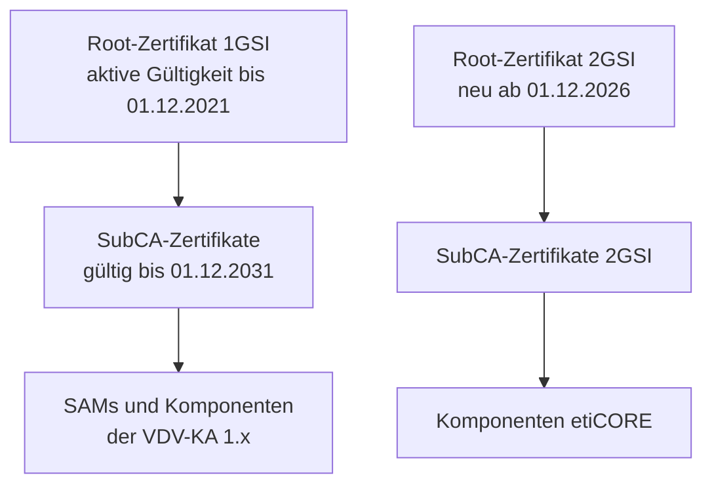

<!-- GEN:breadcrumb -->
[Home](../../README.md) › [Sicherheit](../sicherheit.md) › Public Key Infrastructure
<!-- /GEN:breadcrumb -->

# Public Key Infrastructure

„Mit Public-Key-Infrastructure (PKI) bezeichnet man ein System, das **digitale Zertifikate ausstellen, verteilen und prüfen** kann. Die innerhalb einer PKI ausgestellten Zertifikate werden zur Absicherung rechnergestützter Kommunikation verwendet. Die PKI wird im Umfeld der asymmetrischen Kryptographie eingesetzt.“ ([Q02](../../QUELLEN.md#q02), S. 71)

Die Instanz **Zertifizierung** des Scheme Manager verantwortet die Zertifizierungsverfahren, die Zertifizierung aller Systemkomponenten und „die Erteilung von Zertifikaten für die relevanten Systemkomponenten“ ([Q02](../../QUELLEN.md#q02), S. 100).

Die Hierarchie ist zweistufig, und ihre Daten sind belegt ([Q42](../../QUELLEN.md#q42)) · *Sekundärquelle*:

Vier Festlegungen sind daran wichtig ([Q42](../../QUELLEN.md#q42)):

- Die **aktive Gültigkeit des Root-Zertifikats der 1GSI endete am 1. Dezember 2021** — damit lassen sich keine neuen Zertifikate mehr erstellen. Die bestehenden SubCA-Zertifikate bleiben gültig.
- Diese SubCAs gelten **zehn Jahre bis zum 1. Dezember 2031**, „also bis zum Ende der VDV-Kernapplikation 1.x“.
- Ein **neues Root-Zertifikat** gibt es erst für die 2GSI, mit der Einführung der VDV-Kernapplikation 3.0 als etiCORE **zum 1. Dezember 2026**.
- Im Übergangszeitraum sind **beide** Zertifikate gültig und ermöglichen den Parallelbetrieb.

**Ein verbreiteter Implementierungsfehler**, ausdrücklich benannt ([Q42](../../QUELLEN.md#q42)): Einige Systeme prüfen bei Ausgabe oder Kontrolle, ob das Root-Zertifikat **zu diesem Zeitpunkt** gültig ist. „Das ist falsch und kann seit dem 1. Dezember 2021 zu fehlerhaftem Verhalten des Systems führen!“ Richtig ist die Prüfung, ob das Root-Zertifikat **zum Zeitpunkt der Erstellung des SubCA-Zertifikats** gültig war.

In der KA werden Zertifikate als [CV-Zertifikate](cv-zertifikat.md) übertragen; Keytype 7 bezeichnet das Zertifikat einer CA ([Q06](../../QUELLEN.md#q06), Kap. 4.7).

## Einfach erklärt – Beispiel aus Bärstadt

Eine PKI löst ein Vertrauensproblem zwischen Fremden.

Das Lesegerät am Hauptbahnhof in Bärstadt muss einem Schlüssel aus Luchsstadt vertrauen können, ohne ihn zu kennen. Ein gemeinsames Geheimnis gibt es nicht — und es dürfte auch keines geben, denn dann müsste jedes Gerät jedes andere kennen.

Die Lösung ist eine Vertrauenskette. Ganz oben steht ein **Wurzelzertifikat**. Es bestätigt untergeordnete Zertifizierungsstellen, und diese bestätigen die Zertifikate der einzelnen Komponenten. Das Gerät muss nur dem Wurzelzertifikat vertrauen — alles andere ergibt sich.

Nun zu einem Vorgang, der 2021 real Probleme gemacht hat und erstaunlich lehrreich ist.

Das Wurzelzertifikat der ersten Generation ist am **1. Dezember 2021 abgelaufen**. Nicht die darunterliegenden Zertifikate — nur die Möglichkeit, mit dem Wurzelzertifikat neue auszustellen. Die bestehenden laufen weiter bis Ende 2031.

Dann kam das Problem. Manche Systeme prüften bei jeder Kontrolle: Ist das Wurzelzertifikat **jetzt** gültig? Seit dem 1. Dezember 2021 lautete die Antwort nein — und diese Systeme lehnten ab, obwohl alles in Ordnung war.

Der Fehler ist eine Verwechslung von Zeitpunkten, und man kennt sie vom Personalausweis. Die Frage ist nicht: Ist der Ausweis des Beamten, der meinen Ausweis ausgestellt hat, heute noch gültig? Sondern: War er gültig, **als er meinen Ausweis ausstellte**?

Genau so steht es in der Richtigstellung: Geprüft wird, ob das Wurzelzertifikat zum Zeitpunkt der Erstellung des untergeordneten Zertifikats gültig war.

Für ein Auswertungswerkzeug ist das eine konkrete Prüfregel — und ein gutes Beispiel dafür, dass Sicherheitsfehler meist keine Mathematik sind, sondern Logik.

## Quellen

- [Q02](../../QUELLEN.md#q02) – Glossar VDV-KA / etiCORE, S. 71 („Public Key Infrastructure (PKI)“: System zum Ausstellen, Verteilen und Prüfen digitaler Zertifikate; Einsatz im Umfeld asymmetrischer Kryptographie), S. 100 („Zertifizierung“ als Instanz des Scheme Manager mit Verantwortung für Zertifizierungsverfahren und Erteilung von Zertifikaten), S. 31 („Certification Authority“)
- [Q42](../../QUELLEN.md#q42) – KCD NRW, Newsletterarchiv: SubCA-Bereitstellung; Ende der aktiven Gültigkeit des Root-Zertifikats der 1GSI zum 01.12.2021 bei fortbestehender Gültigkeit der SubCAs; zehnjährige Gültigkeit der SubCAs bis 01.12.2031 „also bis zum Ende der VDV-Kernapplikation 1.x“; neues Root-Zertifikat erst für die 2GSI mit Einführung der VDV-Kernapplikation 3.0 als etiCORE zum 01.12.2026; Gültigkeit beider Zertifikate im Übergangszeitraum; ausdrückliche Richtigstellung des Prüfzeitpunkts · *Sekundärquelle; das KCD NRW gibt Informationen des eTicket Service wieder*
- [Q06](../../QUELLEN.md#q06) – RMV PH 06-02, Kap. 4.7 (CV-Zertifikate, Keytype 7 als Zertifikat einer CA) · *verbundspezifisch*

<!-- GEN:siehe_auch -->
## Siehe auch

- [CV-Zertifikat](cv-zertifikat.md) (CVC)
- [Sicherheitsebenen](sicherheitsebenen.md)
<!-- /GEN:siehe_auch -->

<!-- GEN:navigation -->
---

**Navigation:** [Home](../../README.md) · [Sicherheit](../sicherheit.md) · [Register](../../REGISTER.md)
<!-- /GEN:navigation -->
